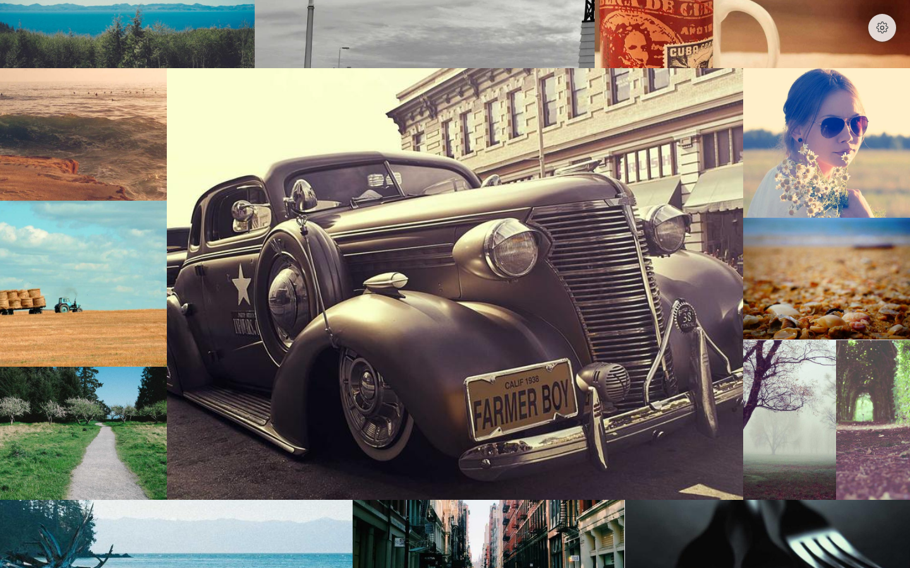
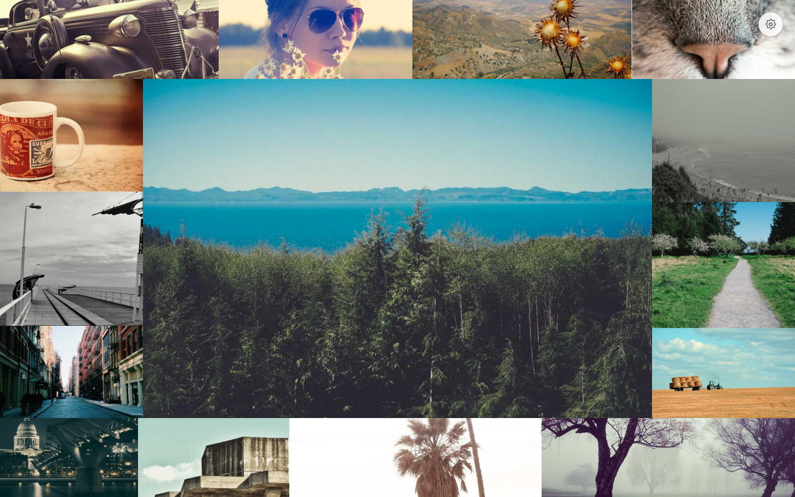
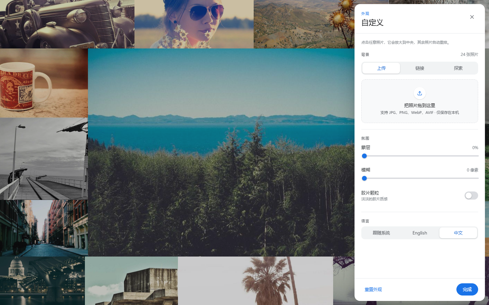

# Lattice

A **photo mosaic with a permanent centre** for your new tab. The selected photo
sits enlarged in the middle, square-cornered and edge-to-edge; the rest of the
wall reflows around it with no gaps and no overlaps. Click another photo and it
swaps into the centre — the old one shrinks back into the mosaic, and everything
glides to its new place. There is no "exit": the composition always has a centre.







## Status

| Stage | Scope | State |
| ----- | ----- | ----- |
| 1 | MV3 manifest, `chrome_url_overrides`, icons | ✅ |
| 2 | Design system, drawer, photo sources | ✅ |
| 3 | Photo library, URL sources, curated sets | ✅ |
| 4 | Material polish, skeletons, reduced motion | ✅ |
| 5 | English / 中文 UI with language switch | ✅ |
| 6 | Gap-free square-cornered mosaic | ✅ |
| 7 | Centre spotlight composition with reflow | ✅ |

## Features

- **Permanent centre photo** — on every new tab a random photo is picked and
  enlarged to the middle of the screen at its natural aspect ratio (no crop).
- **Gapless surroundings** — the remaining space is split into four regions
  (above, below, left, right of the centre) and filled with the other photos
  edge-to-edge, sized as a varied grid and cropped to fit. The viewport is
  covered 100%, with zero overlaps.
- **Click to swap** — click any surrounding photo: it grows into the centre,
  the previous centre shrinks back into the surrounding mosaic, and every tile
  animates to its new rectangle.
- **Irreversible** — there is no dismiss/zoom-out state. The only way to change
  the composition is to select another photo. Clicking the centre does nothing.
- **Square corners, no gutters** — photos meet at right angles across the whole
  screen.
- **Three sources**
  - **Upload** — drop or pick images; downscaled to 1800 px, re-encoded to WebP
    and stored in IndexedDB. Nothing leaves the device.
  - **URLs** — paste any public image link; dimensions are probed and the image
    is cached by the browser.
  - **Explore** — `Classic` ships with the extension (instant + offline);
    `Editorial`, `Noir`, `Soft focus` and `Wide` stream from Lorem Picsum.
- **Bilingual** — English and 中文 with `跟随系统 / Auto / English / 中文`;
  all panel copy, toasts and labels follow the choice.

## Settings

| Group | Controls |
| ----- | -------- |
| Background | Upload · URLs · Explore |
| Atmosphere | Wash · Blur · Film grain |
| Language | Auto · English · 中文 |

## Install (unpacked)

1. Open `chrome://extensions` and enable **Developer mode**.
2. Click **Load unpacked** and select this folder.
3. Open a new tab.

No build step and no runtime dependencies. You can also preview `newtab.html`
directly in a browser: outside the extension `chrome.storage` falls back to
`localStorage`.

## Project layout

```
manifest.json            MV3 manifest (new tab override, storage)
newtab.html              collage, settings button, drawer
style.css                Material tokens, mosaic, atmosphere, drawer
i18n.js                  English/中文 dictionary + DOM applier
store.js                 chrome.storage.local ⇄ localStorage adapter
library.js               IndexedDB library, upload pipeline, curated sets
collage.js               centre spotlight layout with tile reflow
app.js                   selection, drawer, sources, persistence
assets/defaults/         24 bundled photos (instant, offline)
icons/                   generated PNG icons (16/32/48/128)
tools/make-icons.mjs     zero-dependency icon generator
tools/fetch-defaults.mjs refreshes assets/defaults from Lorem Picsum
```

## Layout

```
┌───────────────────────── viewport ─────────────────────────┐
│                 top band (full width)                     │
├───────────────┬───────────────────────┬───────────────────┤
│  left strip   │     CENTRE PHOTO      │   right strip     │
│               │  (natural aspect)     │                   │
├───────────────┴───────────────────────┴───────────────────┤
│                bottom band (full width)                   │
└───────────────────────────────────────────────────────────┘
```

Each band is filled with rows of photos; row heights and column widths are
seeded random, so the mosaic looks different every time. No gaps, no overlaps.

## Storage model

| Data | Where | Notes |
| ---- | ----- | ----- |
| Settings | `chrome.storage.local` → `lattice:settings` | clamped + validated on load |
| Library metadata | `chrome.storage.local` → `lattice:library` | id, kind, dimensions, name |
| Local photo blobs | IndexedDB `lattice-photos/photos` | WebP, max 1800 px, quality 0.82 |
| Local thumbnails | IndexedDB (same record) | 320 px WebP for the drawer |

Uploads are never sent anywhere. Network sets and pasted URLs are fetched by
the browser straight from their host.

## Design tokens

| Token | Purpose |
| ----- | ------- |
| `--bg-blur` | Blur applied to the mosaic |
| `--dim` | Strength of the white wash over the mosaic |
| `--grain-opacity` | Film-grain texture |
| `--blue` / `--ink-*` | Google Material palette |

## Shortcuts

| Key | Action |
| ---- | ------ |
| `S` | New random composition and centre |
| `Esc` | Close settings |

## Icons & default photos

```bash
node tools/make-icons.mjs      # regenerate the extension icons
node tools/fetch-defaults.mjs  # refresh the bundled photo set
```

Bundled and curated photos come from [Lorem Picsum](https://picsum.photos),
which re-hosts photography from [Unsplash](https://unsplash.com) under the
Unsplash License.
