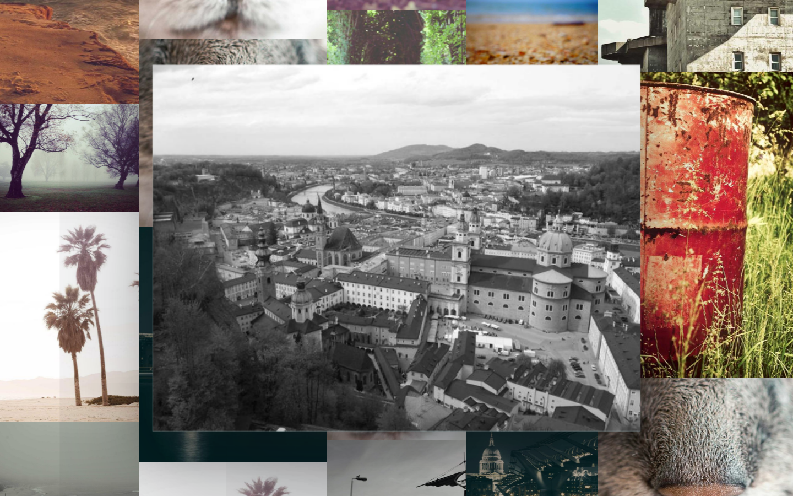

# Lattice

An **endless, gap-free photo mosaic** for your new tab. Photos tile the plane
flush — square corners, no gutters, no overlaps — and the wall keeps going in
every direction. Click a photo and that photo itself grows in place while the
camera simply pans to centre it. One small settings button, no clock, no search
bar, **English / 中文**.





## Status

| Stage | Scope | State |
| ----- | ----- | ----- |
| 1 | MV3 manifest, `chrome_url_overrides`, icons | ✅ |
| 2 | Design system, drawer, photo sources | ✅ |
| 3 | Photo library, URL sources, curated sets | ✅ |
| 4 | Material polish, skeletons, reduced motion | ✅ |
| 5 | English / 中文 UI with language switch | ✅ |
| 6 | Endless wall, drag-to-pan | ✅ |
| 7 | Non-overlapping masonry | ✅ |
| 8 | Flush square-cornered tiling, in-place photo zoom | ✅ |

## Features

- **Flush tiling, no gaps** — columns with varying widths sit edge to edge and
  photos stack inside them at their natural aspect ratio with zero spacing.
  Every pixel of the plane is covered, and nothing overlaps anything else.
- **Square corners** — photos meet at right angles, like a contact-sheet
  mosaic.
- **Random sizes** — column widths vary within a repeating cycle and heights
  follow each photo's aspect ratio, so small and large frames alternate across
  the wall.
- **Endless in both axes** — every column repeats with its own vertical period,
  so dragging generates new photos forever. Only columns near the viewport stay
  in the DOM.
- **Click = photo zoom, camera pan** — the clicked photo scales up in place (up
  to 3.5×) while the camera only translates to put it in the centre; the other
  photos keep their size. Click anywhere or press `Esc` to glide back.
- **Drag with inertia** — grab anywhere on the wall and flick it; there are no
  edges to hit.
- **Three sources**
  - **Upload** — drop or pick images; downscaled to 1800 px, re-encoded to WebP
    and stored in IndexedDB. Nothing leaves the device.
  - **URLs** — paste any public image link; dimensions are probed and the image
    is cached by the browser.
  - **Explore** — `Classic` ships with the extension (instant + offline);
    `Editorial`, `Noir`, `Soft focus` and `Wide` stream from Lorem Picsum.
- **Bilingual** — English and 中文 with `跟随系统 / Auto / English / 中文`;
  all panel copy, toasts and labels follow the choice.

## Settings

| Group | Controls |
| ----- | -------- |
| Background | Upload · URLs · Explore |
| Atmosphere | Wash · Blur · Film grain |
| Language | Auto · English · 中文 |

Layout controls (density, tilt, gap, radius, tile shape) are gone: the wall now
tiles itself so photos stay whole and tight.

## Install (unpacked)

1. Open `chrome://extensions` and enable **Developer mode**.
2. Click **Load unpacked** and select this folder.
3. Open a new tab.

No build step and no runtime dependencies. You can also preview `newtab.html`
directly in a browser: outside the extension `chrome.storage` falls back to
`localStorage`.

## Project layout

```
manifest.json            MV3 manifest (new tab override, storage)
newtab.html              collage, settings button, drawer
style.css                Material tokens, wall, atmosphere, drawer
i18n.js                  English/中文 dictionary + DOM applier
store.js                 chrome.storage.local ⇄ localStorage adapter
library.js               IndexedDB library, upload pipeline, curated sets
collage.js               endless gap-free tiling + camera
app.js                   panning, photo zoom, drawer, persistence
assets/defaults/         24 bundled photos (instant, offline)
icons/                   generated PNG icons (16/32/48/128)
tools/make-icons.mjs     zero-dependency icon generator
tools/fetch-defaults.mjs refreshes assets/defaults from Lorem Picsum
```

## Storage model

| Data | Where | Notes |
| ---- | ----- | ----- |
| Settings | `chrome.storage.local` → `lattice:settings` | clamped + validated on load |
| Library metadata | `chrome.storage.local` → `lattice:library` | id, kind, dimensions, name |
| Local photo blobs | IndexedDB `lattice-photos/photos` | WebP, max 1800 px, quality 0.82 |
| Local thumbnails | IndexedDB (same record) | 320 px WebP for the drawer |

Uploads are never sent anywhere. Network sets and pasted URLs are fetched by
the browser straight from their host.

## Design tokens

| Token | Purpose |
| ----- | ------- |
| `--bg-blur` | Blur applied to the wall |
| `--dim` | Strength of the white wash over the wall |
| `--grain-opacity` | Film-grain texture |
| `--blue` / `--ink-*` | Google Material palette |

## Shortcuts

| Key | Action |
| ---- | ------ |
| `S` | Shuffle into a brand-new wall |
| `Esc` | Shrink the focused photo / close settings |

## Icons & default photos

```bash
node tools/make-icons.mjs      # regenerate the extension icons
node tools/fetch-defaults.mjs  # refresh the bundled photo set
```

Bundled and curated photos come from [Lorem Picsum](https://picsum.photos),
which re-hosts photography from [Unsplash](https://unsplash.com) under the
Unsplash License.
