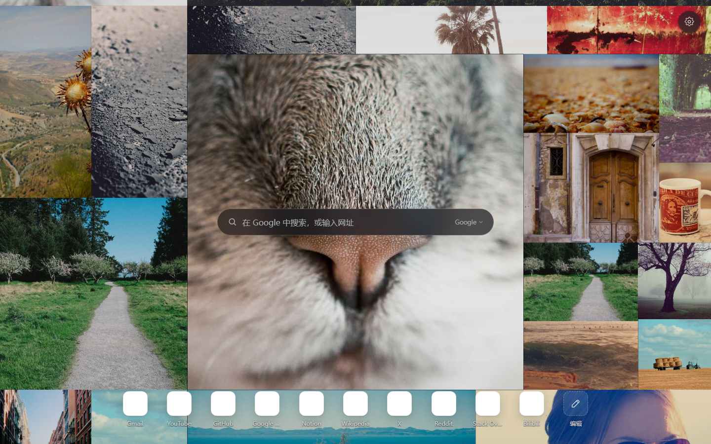

# Lattice

An **infinite, draggable photo wall** for your new tab, rebuilt around the
Lattice module of [folia-major](https://github.com/chthollyphile/folia-major):
12-card block templates, viewport culling, a world/camera split, and an
expansion that re-gears only the block you clicked. English / 中文.




## Status

| Stage | Scope | State |
| ----- | ----- | ----- |
| 1 | MV3 manifest, `chrome_url_overrides`, icons | ✅ |
| 2 | Design system, drawer, photo sources | ✅ |
| 3 | Photo library, URL sources, curated sets | ✅ |
| 4 | Material polish, skeletons, reduced motion | ✅ |
| 5 | English / 中文 UI with language switch | ✅ |
| 6 | Endless draggable wall | ✅ |
| 7 | Block templates, reflections, viewport culling | ✅ |
| 8 | 6×6 expansion with local block reflow | ✅ |
| 9 | Glow / inner stroke, smart framing | ✅ |
| 10 | Shortcut row from most-visited sites | ✅ |
| 11 | White wall background and shortcut editing | ✅ |
| 12 | Shortcut row, drag reorder, custom icons | ✅ |
| 13 | Auto / Light / Dark appearance | ✅ |
| 14 | Search over the centre photo | ✅ |

## Features

- **Block templates, borrowed from folia-major** — a 12×8 block is covered
  exactly by 12 cards in four base templates, each mirrored in X and Y. The
  template and reflection follow the block's coordinates, so the field never
  reads as a plain grid and tile sizes vary naturally.
- **Endless and virtualised** — blocks repeat over an unbounded world; only
  blocks inside the viewport plus an overscan are instantiated, capped at 400
  tiles. Dragging changes the camera offset, not the layout.
- **Expand at the photo's own aspect** — clicking a card expands it to a large
  card sized from the photo's real aspect ratio, so the whole image is shown
  (`object-fit: contain`, no crop). The other eleven cards of **that same
  block** re-gear around it and keep the block exactly covered; no other block
  moves. The card is capped to the viewport at the current camera scale.
  Clicking another card switches the expansion, clicking the open card (or a
  gap / `Esc`) collapses it.
- **Camera glide** — the camera pans to the expanded card; the expanded card
  gets an inset focus ring and an inner peach glow.
- **Search over the photo** — a frosted search pill sits in the middle of the
  expanded photo and follows it as the card moves. Type a query and press Enter,
  paste a URL to open it, or switch the chip between Google, Bing and
  DuckDuckGo. `/` focuses the field; the chip's engine is remembered.
- **Smart framing** — artwork fills the card's gear with `object-fit: cover`
  and a focus point (`object-position`). The focus point comes from the
  browser's `FaceDetector` when available and falls back to centre; the
  mechanism mirrors folia's `cardArtwork` / avatar-focus idea.
- **Shortcut row** — a familiar row of shortcuts sits at the bottom of the
  page: the favicon on a white tile with the site name underneath. Entries come
  from Chrome's most-visited sites (`topSites`) and fall back to a built-in list
  (Gmail, YouTube, GitHub, Notion, Wikipedia, …). Clicking one opens the site.
- **Editable shortcuts** — the pencil at the end of the row enters edit mode:
  add, rename, re-point or delete shortcuts, pick a **custom icon** (resized to
  64 px and stored with the shortcut), and drag tiles to reorder them. The list
  is stored in `chrome.storage.local`.
- **Light wall** — the backing of the wall (and the placeholder of cards while
  photos decode) is a soft white (`#f1f3f4`), so loading and empty edges read
  bright rather than black.
- **Night mode** — Appearance offers Auto / Light / Dark. Auto follows the
  system scheme live; dark mode restyles the wall backing, drawer, controls,
  shortcut row, editor dialog and settings button, and adds a subtle night wash
  over the photos. The choice is stored with the other settings and mirrored to
  localStorage so the first frame is already dark.
- **Three sources**
  - **Upload** — drop or pick images; downscaled to 1800 px, re-encoded to WebP
    and stored in IndexedDB. Nothing leaves the device.
  - **URLs** — paste any public image link; dimensions are probed and the image
    is cached by the browser.
  - **Explore** — `Classic` ships with the extension (instant + offline);
    `Editorial`, `Noir`, `Soft focus` and `Wide` stream from Lorem Picsum.

## Settings

| Group | Controls |
| ----- | -------- |
| Background | Upload · URLs · Explore |
| Atmosphere | Wash · Blur |
| Appearance | Auto · Light · Dark |
| Language | Auto · English · 中文 |

## Layout

```
┌────────────── 12 × 8 block (one of 4 templates, mirrored) ──────────────┐
│  2×2 │ 2×2 │      4×3      │ 2×4 │ 2×4 │                                │
│      │     │               │     │     │                                │
│ 2×3  │ 2×2 │      4×3      │      4×4      │                            │
│      │     │               │               │                            │
│ 2×3  │        6×2          │     (varied gears, exact cover)            │
└──────────────────────────────────────────────────────────────────────────┘
```

Clicking any card expands it at the photo's own aspect ratio; the rest of the
block re-tiles around it and the camera centres it. The cards touch, so the
wall reads as one seamless mosaic.

Permissions: `storage`, `unlimitedStorage`, `topSites` (most-visited
shortcuts) and `favicon` (local favicon lookups via `/_favicon/`). Photo
uploads never leave the device.

## Install (unpacked)

1. Open `chrome://extensions` and enable **Developer mode**.
2. Click **Load unpacked** and select this folder.
3. Open a new tab.

No build step and no runtime dependencies. You can also preview `newtab.html`
directly in a browser: outside the extension `chrome.storage` falls back to
`localStorage`.

## Project layout

```
manifest.json            MV3 manifest (new tab override, storage)
newtab.html              collage, settings button, drawer
style.css                Material tokens, wall, cards, atmosphere, drawer
i18n.js                  English/中文 dictionary + DOM applier
theme.js                 pre-paint theme resolution (localStorage cache)
store.js                 chrome.storage.local ⇄ localStorage adapter
library.js               IndexedDB library, upload pipeline, curated sets
shortcuts.js             most-visited sites + built-in shortcut fallbacks
collage.js               block templates, culling, block reflow, camera
app.js                   camera input, expansion, drawer, sources, persistence
assets/defaults/         24 bundled photos (instant, offline)
icons/                   generated PNG icons (16/32/48/128)
tools/make-icons.mjs     zero-dependency icon generator
tools/fetch-defaults.mjs refreshes assets/defaults from Lorem Picsum
```

## Storage model

| Data | Where | Notes |
| ---- | ----- | ----- |
| Shortcuts | `chrome.topSites` (permission `topSites`) | built-in fallback list |
| Settings | `chrome.storage.local` → `lattice:settings` | clamped + validated on load |
| Library metadata | `chrome.storage.local` → `lattice:library` | id, kind, dimensions, name |
| Local photo blobs | IndexedDB `lattice-photos/photos` | WebP, max 1800 px, quality 0.82 |
| Local thumbnails | IndexedDB (same record) | 320 px WebP for the drawer |

Uploads are never sent anywhere. Network sets and pasted URLs are fetched by
the browser straight from their host.

## Shortcuts

| Key | Action |
| ---- | ------ |
| `/` | Focus the centre search |
| `S` | New random wall and expanded card |
| `Enter` | Expand the focused card |
| `Esc` | Collapse the expanded card / close settings |

## Credits

The block layout system, its four templates and reflections, the 6×6 expansion
idea and the focus styling are adapted from **folia-major** by
[chthollyphile](https://github.com/chthollyphile/folia-major)
(`src/components/wall/blockTemplates.ts`, `layout.ts`,
`src/components/app/lattice/PosterWall.tsx`). This port implements its own
reflow solver so the block stays exactly covered when a card expands.

Bundled and curated photos come from [Lorem Picsum](https://picsum.photos),
which re-hosts photography from [Unsplash](https://unsplash.com) under the
Unsplash License.
